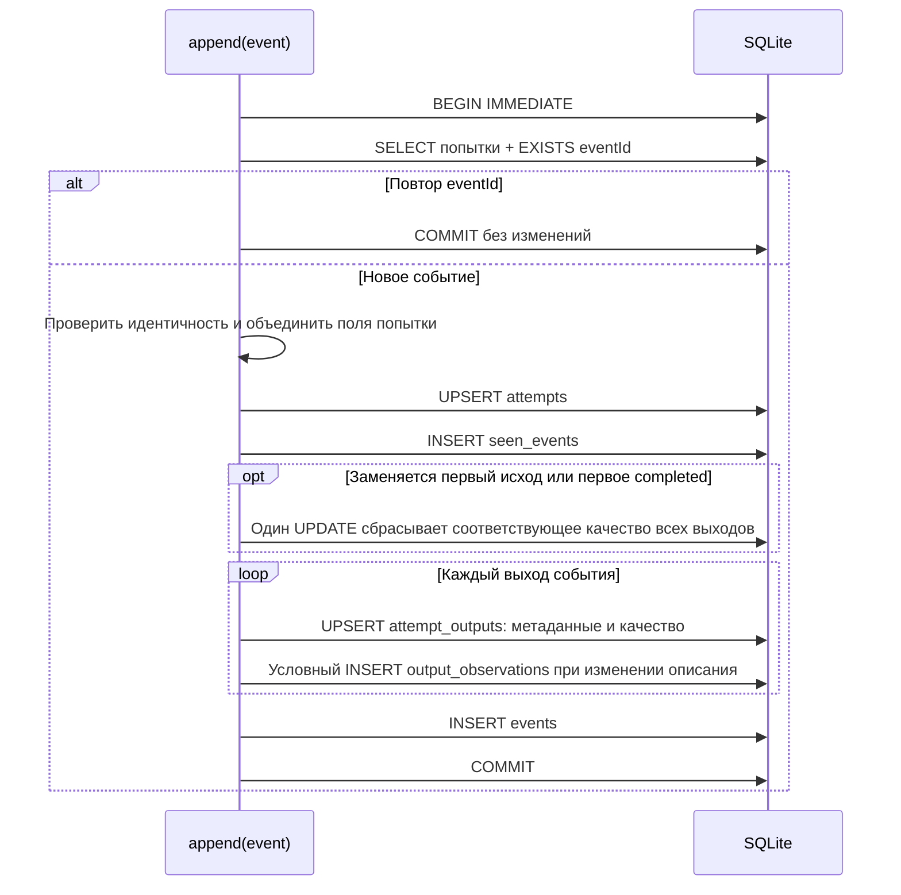
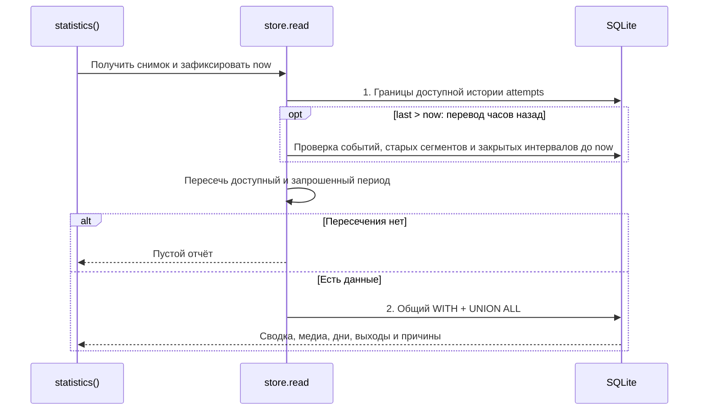
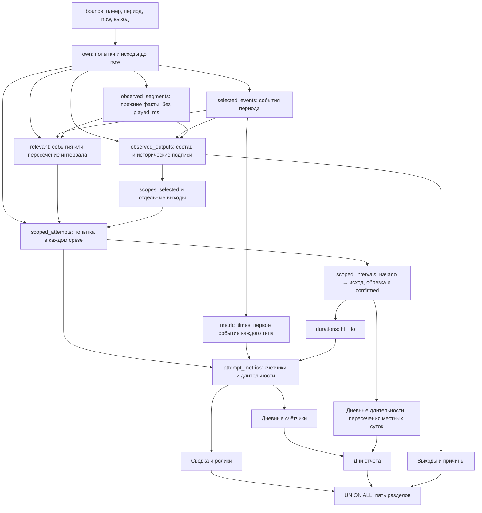

# Как устроены SQL-расчёты статистики воспроизведения

Пользовательские значения показателей описаны в
[README](../../README.md#статистика-воспроизведения). Основные файлы:
[PlaybackStatisticsSqlReader](../../packages/main/src/playbackStatisticsSql.ts),
[PlaybackStatisticsStore](../../packages/main/src/playbackStatisticsStore.ts),
[playbackStatisticsDatabase.ts](../../packages/main/src/playbackStatisticsDatabase.ts) и
[playbackStatisticsDailySql.ts](../../packages/main/src/playbackStatisticsDailySql.ts).

## Формула длительности

С 5.6.6 одна попытка даёт один календарный интервал: фактическое начало воспроизведения
→ первый исход `completed`, `error` или `interrupted`. Начало — первый принятый кадр декодера
или событие `playing` capture-движка. `started_at` имеет приоритет; при его отсутствии
используется переданное `declared_started_at`. `skipped` не закрывает интервал.

`playedMs` — пересечение этого интервала с периодом и сохранившейся историей. Паузы,
ожидание кадров и перемотки не вычитаются; промежутки между попытками не входят.
Отсутствие начала, отсутствие исхода и обратная пара времён дают ноль.
Незавершённую попытку не достраиваем до текущего `now` или последнего наблюдения.

`successfulMs` получает тот же интервал целиком только при первом исходе `completed`
и статусе `confirmed` выбранного среза. В общем срезе требуется подтверждение всех выходов,
в срезе одного выхода — его подтверждение. `partial` и `unconfirmed` дают ноль исправного
времени, но их счётчики сохраняются. Терминальное качество накапливается главным процессом
по состояниям выходов независимо от кадрового прогресса.

Старые `segments` и `segments_output` остаются для состава истории, метаданных выходов
и границ сохранившихся фактов. Поля `played_ms`, `all_showing` и `showing` не участвуют
в длительностях. Нет оконного удаления перекрытий сегментов и пропорциональных весов.
Новый preload не отправляет `progress`; главный процесс игнорирует такие входящие события.
Контроль кадров и позиции для watchdog остаётся отдельным механизмом.

## Согласованный снимок

Файловая WAL-база имеет два соединения и две очереди. Писатель сериализует запись,
очистку и `write()` в транзакциях `BEGIN IMMEDIATE`/`COMMIT`. Читатель ждёт ранее принятые
записи, открывает `BEGIN` и служебным SELECT фиксирует снимок до callback. Последующие
события записываются параллельно и попадут в следующий отчёт. Все запросы одного отчёта
видят один снимок; `now` фиксируется внутри callback после ожидания очереди.
Для `:memory:` используется одно соединение и общая очередь: WAL там недоступен.

Имена `own`, `scoped_intervals`, `durations` — CTE внутри SQL, а не отдельные вызовы из JS.
`AS MATERIALIZED` сохраняет выборку только на время текущего выражения; постоянного
кэша длительности нет. Граф ниже показывает зависимости данных, не физический план SQLite.

## Порядок записи события

При записи проверяются формат события и нижняя граница хранения. Верхняя граница `now`
применяется только при чтении отчёта: часы renderer и main на одной Windows могут различаться
на 1 мс, поэтому проверка `event.timestamp > now` при записи теряла реальные запуски и исходы.
Исходные даты сохраняются без округления или замены временем приёма, в том числе после
перевода часов назад. Такие факты переживают очистку и перезапуск; отчёт учитывает их после
достижения соответствующей даты. Схема SQLite и протокол событий не меняются.

Попытку читаем целиком и объединяем её поля в TypeScript, затем записываем одним UPSERT.
`BEGIN IMMEDIATE` берёт блокировку писателя **до чтения** и удерживает до COMMIT: другой
писатель не может изменить прочитанную строку между чтением и записью. Постоянного кэша
в памяти нет. При ошибке откатываются все изменения, включая `seen_events`, поэтому
повторная доставка после ошибки остаётся возможной. Повтор уже принятого `eventId`
игнорируется до проверки идентичности payload, как и раньше.

Сложная часть — события, доставленные не по порядку. Первый terminal и первое `completed`
выбираются независимо по времени события; при равных timestamp остаётся уже принятый
результат. Если приходит более ранний исход, соответствующее качество сначала сбрасывается
у **всех** выходов попытки, затем новый результат записывается вместе с метаданными.
Так выход, отсутствующий в новом результате, не наследует прежнее подтверждение.
Другая категория качества при этом сохраняется.

Историческое описание выхода сравнивается с последним наблюдением не позже события
внутри условного INSERT. Неизменившееся описание не создаёт строку; `IS` сравнивает
nullable-назначения дисплея. Схема таблиц и содержимое событий истории не меняются.
Диаграмма показывает обычные события; сохранённая ветка `progress` в store пишет
`segments` и `segments_output` вместо `events`, но новый сборщик её не использует.

Для одного выхода обычный `started` выполняет 8 команд, `completed` — 9. Это включает
BEGIN/COMMIT каждого события, но не инициализацию базы и суточную очистку. Неизменившееся
описание выхода тоже проверяется одной командой. Две транзакции сохраняются: начало
и завершение ролика фиксируются сразу по поступлении.

## Порядок запросов отчёта

Обычная непустая сводка делает два запроса callback, при откате часов — три.
Служебные команды фиксации снимка не включены в это число. Границы относятся ко всему
плееру, до фильтра выхода. Fallback не подставляет выдуманное наблюдение в `now`.

История сохраняет прежний порядок: один запрос возвращает COUNT кандидатов и
`history_page` с LIMIT/OFFSET, затем два запроса получают результаты выходов и события
только выбранной страницы. Пустая страница сохраняет total и не запрашивает детали.
Длительность рассчитывается для попыток страницы по той же формуле начала/исхода.
События истории и интерфейс не меняются; время в компактной строке истории не повторяется.
Детали содержат события всей попытки до `now`, не только выбранного периода;
при превышении 1000 событий добавляется `details-truncated`.

## От фактов к отчёту

`relevant` включает попытку при событии периода, сохранённом старом сегменте или
пересечении завершённого интервала. Это позволяет учитывать попытку, которая пересекает
весь период без событий внутри него. `scopes` создаёт общий/выбранный срез и, для сводки,
отдельные срезы выходов; суммировать эти срезы между собой нельзя.
Имена выходов берутся из `output_observations` на момент исторического наблюдения.
Если сохранился только поздний исход с `startedAt`, а более раннего снимка нет,
используется первое доступное наблюдение выхода не позднее `now`.

## Что сохранить при ревью

- Границы точечных событий: `at >= lo`, `at <= hi`, `at < finish`, `at <= now`.
  `finish` — начало суток после конечной даты. Длительности используют пересечение
  через MAX/MIN, нулевое пересечение не даёт времени. Будущие исходы при откате часов скрыты.
- `metric_times` берёт первое событие каждого типа в выбранном периоде. Счётчики
  `completed` и его качество опираются на отдельно сохранённый `completed_status`;
  история и длительность — на первый терминальный исход. Наличие позднего completed
  после первого error не превращает интервал в исправное время.
- Дни задаются местными календарными границами хоста. При DST сутки могут иметь 23 или
  25 часов; шаг в 86 400 000 мс их не заменяет. События относятся к своим моментам,
  длительность пересекается с каждым днём. `hasRecords` учитывает диагностические события
  и старые факты независимо от ненулевых показателей.
- Последнее имя ролика выбирается одним ранжированием по `filename_at DESC,id DESC`.
  Числовые идентификаторы дисплеев возвращаются колонками SQLite без JSON-преобразования.
- События дедуплицируются по `eventId`, идентичность player/media попытки неизменна.
  Очистка удаляет просроченные факты и ненужные попытки каскадно, сохраняя нужный контекст
  выходов. Старые сегменты очищаются по прежним правилам, но не задают новое время.

API статистики доступен с 5.6.5. Ответ нового расчёта содержит `durationBasis: 'wall-clock'`.
Интерфейс поясняет новую формулу только при `supportsFeature('playbackWallClockDuration',
remoteHostVersion, isRemoteSession)` (минимум 5.6.6) и этом поле ответа. Это защищает ранние
тестовые сборки 5.6.6 со старой формулой. Новых запросов/IPC нет; прежний fallback HTTP 404
сохраняется. Локальная работа следует существующей политике helper.

Стоимость чтения зависит от числа попыток, событий и выходов в периоде. Анализа кадров и
оконной обработки сегментов в расчёте времени больше нет. Долгое чтение всё ещё удерживает
WAL-снимок и может отложить освобождение его страниц.
Поведение проверяется [SQL-тестами](../../packages/main/test/playbackStatisticsSql.test.ts),
[тестами store](../../packages/main/test/playbackStatisticsStore.test.ts) и
[тестами подключения](../../packages/main/test/playbackStatisticsDatabase.test.ts).
Это не подтверждение физического изображения на дисплее.

## Сравнение нового расчёта, 11 октября 2026

Локальная копия базы `.6`: 16 812 попыток, 19 675 старых сегментов; период 9–10 октября.
Оба варианта запускались на одной копии с одинаковыми параметрами в чередующемся порядке.
Ниже медианы четырёх прогретых запусков полного `statistics()`, без сети и интерфейса.
Работающий плеер `.6` при этой проверке не затрагивался.

| Сводка | Прежняя формула | Новая формула | Сокращение времени |
| --- | --- | --- | --- |
| Плеер 1 | 206 мс | 161 мс | 22% |
| Плеер 2 | 263 мс | 216 мс | 18% |

Число запросов сводки осталось равным двум. Счётчики и сведения истории на этой копии
сравнены с прежним читателем: без полей длительности результаты совпали (семь роликов,
до 100 записей истории каждого). Значения длительности намеренно изменились.

До объединения команд записи отдельный замер попытки с одним уже известным выходом: `started + progress + completed`
выполняли 39 команд SQLite вместе с BEGIN/COMMIT, `started + completed` — 28 команд.
При первом появлении выхода нужна ещё одна запись его описания: соответственно 40 и 29 команд.
Это примерно на 28% меньше команд и две транзакции вместо трёх; новые строки `segments` и
`segments_output` не создаются. При нескольких прежних сегментах экономия больше.
Это подсчёт операций, а не обещание такого же процента ускорения записи на устройстве.

Сбор упрощён существенно: удалены покадровый накопитель и разбиение прогресса по состояниям
выходов. Из SQL длительностей убраны оконная сортировка сегментов, устранение перекрытий и
пропорциональные веса. Весь файл читателя короче не стал: остались срезы выходов, история,
совместимость со старыми фактами и добавилась обработка восстановленных интервалов.

## Сравнение объединённой записи, 11 октября 2026

Сравниваются два варианта уже после перехода на календарные интервалы: прежняя запись
несколькими UPDATE и объединённая запись выше. Одна попытка — `started + completed`.
Замер локальный, на файловых WAL-базах с одинаковым начальным состоянием: разогрев,
затем девять раундов по 300 попыток с чередованием порядка вариантов. Подсчёт команд
проводился отдельно от замера времени. Ни сеть, ни интерфейс, ни сводка сюда не входят.

| Выходы и описания | Команды до → после | Медиана времени до → после | Сокращение времени |
| --- | --- | --- | --- |
| 1, уже известное описание | 28 → 17 | 0,685 → 0,559 мс | 18% |
| 1, новое описание | 29 → 17 | 0,728 → 0,567 мс | 22% |
| 3, уже известные описания | 40 → 25 | 0,990 → 0,829 мс | 16% |
| 3, новые описания | 43 → 25 | 1,037 → 0,840 мс | 19% |

Команды — вызовы `sqlite3.Database.get/run/exec`, включая четыре BEGIN/COMMIT на попытку,
а не число физических записей на диск. Для одного известного выхода сокращение обращений
составляет 39%. На `.6` новый вариант пока не запускался; локальный результат не является
замером ускорения на устройстве.

Все семь таблиц сравнивались целиком после каждого события: 34 контрольные точки,
481 событие с детерминированно перемешанной доставкой и отдельный случай с 4096 выходами.
Сводка и история совпали до и после очистки, включая фильтры выходов и пагинацию.
В репозитории добавлены [тесты безопасности записи](../../packages/main/test/playbackStatisticsWriteSafety.test.ts):
откат при ошибке последнего INSERT, повтор после отката, дубли с изменённым payload,
одновременные повторы и замена качества при более раннем исходе с неполным составом выходов.

## Исторические замеры прежнего расчёта на `.6`, 10 октября 2026

Эти замеры относятся к прежней формуле по кадровому прогрессу, до перехода на интервалы
начала и первого исхода. Они сохранены как диагностические данные; это не показатели
производительности и не описание формулы текущей реализации.

Проверка выполнена на отдельной копии базы: 17 544 попытки, 20 544 сегмента, период 9–10 октября.
Использован SQLite 3.52.0 из установленного Electron; работающий плеер не заменялся.
Варианты без постоянных агрегатов сравнивались поочерёдно, четыре прогретых запуска каждого.
Все возвращённые SQL-строки совпали полностью, включая дробные длительности.

| Полная сводка | CPU до / после | Полное время до / после, медиана |
| --- | --- | --- |
| Плеер 1 | 2,402 / 2,187 с | 4,415 / 4,224 с |
| Плеер 2 | 3,336 / 3,127 с | 5,680 / 5,622 с |

Изменения соединений и ширины строк снизили процессорную стоимость на 8,9% и 6,2%.
Полное время сильно колебалось: на двухъядерном Celeron N3050 во время диагностики load average
был около 11–12. Ускорение SQL не устраняет конкуренцию с воспроизведением и остальными процессами.
Это замеры самого общего SQL на копии, без очереди HTTP/API и отрисовки интерфейса.

Поэтапные запросы к CTE показали существенную стоимость отбора фактов и состава выходов ещё до
расчёта времени. Обычный запрос также создавал около 6,1 / 15,6 МБ временных записей; после
сужения строк — около 3,2 / 13,5 МБ. В этих прогретых запусках физического чтения с диска
не было по счётчику `read_bytes`. Принудительный `temp_store=MEMORY` не дал устойчивого выигрыша
для обоих плееров, поэтому настройка не менялась. Времена отдельных CTE нельзя складывать:
они включают общие зависимости, а при выборе одного этапа SQLite может построить другой план.

### Измеренное и расчётное время

Расчётное время здесь — `число завершений × media.duration`; длительности взяты из медиатеки
того же хоста. Это был эксперимент без изменения тогдашней формулы показателей.

| Плеер | Расчётное, ч | Активное, ч | Исправное, ч | Активное относительно расчётного |
| --- | --- | --- | --- | --- |
| 1 | 16,0323 | 15,3203 | 15,3141 | −4,44% |
| 2 | 14,7375 | 14,5212 | 14,5197 | −1,47% |

По отдельным роликам отклонение составляет от −1,47% до −7,91%. Для 5-секундного ролика
«Инженерные решения» 1153 завершения дают 5765 с по длительности файла, а сводка — 5308,759 с
активного времени. Проверка сырых сегментов завершённых попыток даёт в среднем 4,604 с на попытку;
разница возникает до SQL-сводки, а не при её итоговом округлении. Между `started` и `completed`
для этих попыток в среднем 4,727 с; это наблюдения программы, не измерение физического экрана.

Прежний сборщик `PlaybackProgress` суммировал продвижение позиции между наблюдениями кадров и ограничивал
его временем сегмента; длительные задержки отделялись. Для декодера первое наблюдение задаёт
начальную позицию, а EOF только завершает накопленный сегмент — не дописывает время до паспортной
длительности. `completed` не проверяет равенство накопленного времени длительности файла.
В журнале этих попыток нет позиций первого и последнего кадров, поэтому точное распределение
расхождения между границами кадров и ограничением сегментов по этим данным не восстановить.
Округление итогов до миллисекунд такой разницы объяснить не может.

Расчётное время подходит для оценки объёма завершённых показов, но не является эквивалентом
наблюдаемого активного или исправного времени. Незавершённые попытки, переход через границу
периода и частично исправный вывод дополнительно различали эти показатели. Текущий расчёт
использует реальные границы попытки, а не паспортную длительность файла.

### Куда уходит календарное время между показами

Отдельно проверено предположение о промежутках между роликами. Для каждого плеера взят один
интервал от первого до последнего факта этой копии (примерно 16 ч 4 мин). Объединение интервалов
`started_at → terminal_at` сравнивалось с объединением сырых сегментов; у текущей незавершённой
попытки вместо отсутствующего terminal использовался последний факт. Перекрытий между попытками
на этих данных нет, все промежутки лежат внутри исследуемого интервала.

| Плеер | Прошло | Активное | Между попытками | Остаток внутри попыток |
| --- | --- | --- | --- | --- |
| 1 | 16:04:30 | 15:19:13 | 00:31:11 | 00:14:06 |
| 2 | 16:04:28 | 14:31:16 | 01:26:44 | 00:06:28 |

Значения округлены до секунд независимо. Средний промежуток — 270 и 490 мс, медиана — 254 и
449 мс. Промежутки объясняют соответственно 68,9% и 93,1% разницы между календарным и активным
временем. Остаток включает разрывы наблюдений внутри попыток и ограничение `played_ms` временем
сегмента. Это отличается от сравнения с `число завершений × длительность`: календарное время
включает и смену роликов. Журнал не показывает, был ли в промежутке чёрный экран или оставался
последний кадр, и не позволяет считать весь этот остаток временем отсутствия физического вывода.
